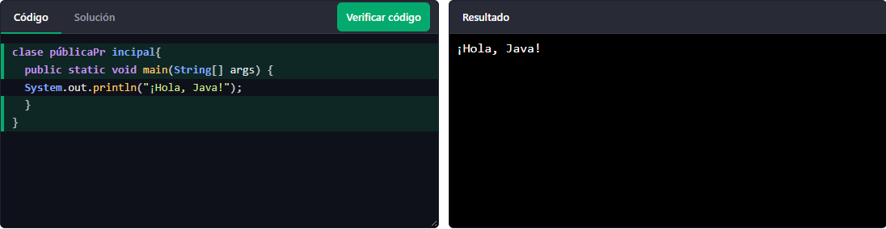
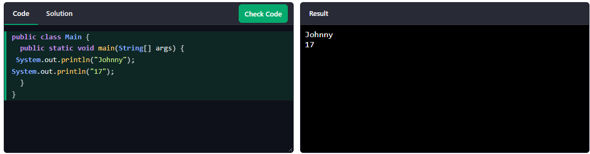
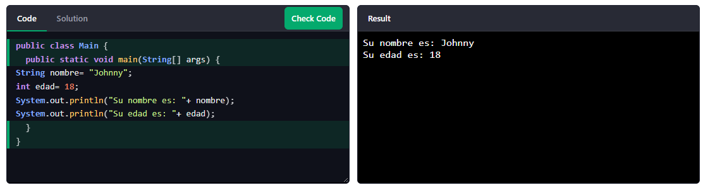
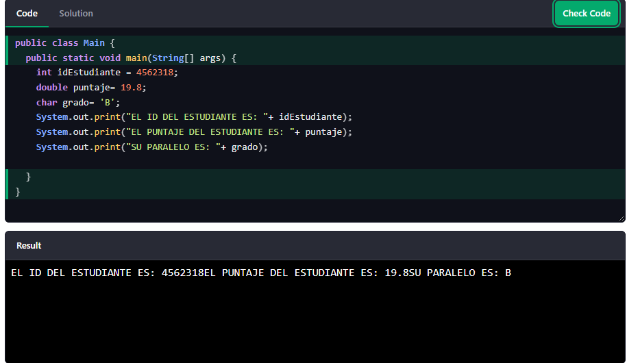
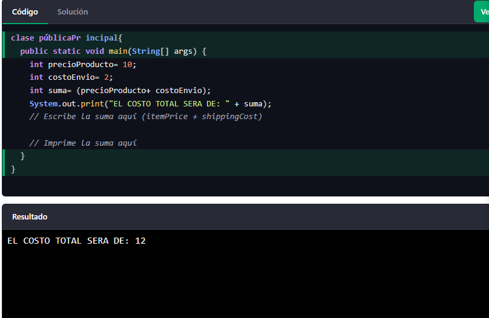
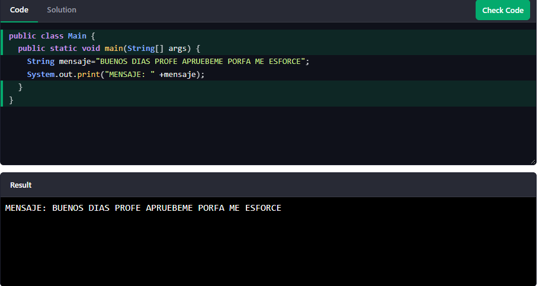
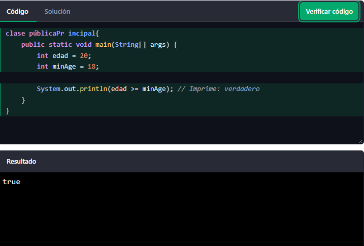

# FUNDAMENTOS DE PROGRAMACION
# HOME
Es la pagina principal del sitio web de Java, donde se encuentra una introduccion general al lenguaje de programacion, sus caracteristicas, herramientas y recursos para aprender a usarlo.
public class Main {
  public static void main(String[] args) {
    System.out.println("Hola Mundo");
  }
}
# INTRO
Aqui estan los conceptos basicos de java y explica que es este lenguaje de programacion, para que sirve y cuales son sus principales caracteristicas.
public class Main {
  public static void main(String[] args) {
    String name = "Johnny";
    System.out.println("Hello " + name);
  }
}
# JAVA GET STARTED
Este es el apartado que explica como empezar a trabajar o a realizar mi proyecto en Java. Incluye los pasos para instalarlo, configurarlo y como ejecutar correctamente los programas.
public class Main {
  public static void main(String[] args) {
    System.out.println("Hola Mundo");
  }
}

## JAVA SINTAX
# SYNTAX
La sintaxis de Java es el conjunto de reglas gramaticales obligatorias que determinan cómo se debe escribir el código para que la computadora lo entienda y lo ejecute correctamente.
public class Main {
  public static void main(String[] args) {
    System.out.println("Hola Mundo");
  }
}
# STATEMENTS
Son las instrucciones que se escriben en Java para indicar al programa que acciones debe realizar y se coloca ; al terminar cada linea.
public class Main {
  public static void main(String[] args) {
    System.out.println("¡Hola mundo!");
    System.out.println("¡Que tengas un buen día!");
    System.out.println("Aprender Java es divertido!");
  }
}
# CODE CHALLENGE

## JAVA OUTPUT

# PRINT TEXT 
Permite mostrar mensajes o textos en la consola utilizando:
public class Main {
  public static void main(String[] args) {
    System.out.println("Hola Mundo");
    System.out.println("¡Que tengas un buen día!");

  }
}
# PRINT NUMBERS
Permite mostrar valores numericos en la consola sin necesidad de usar comillas, se pueden imprimir numeros enteros y en decimales.
public class Main {
  public static void main(String[] args) {
    System.out.println(3);
    System.out.println(358);
    System.out.println(50000);
  }
}
# CODE CHALLENGE

# JAVA COMENTS
Los comentarios pueden utilizarse para explicar el código Java y hacerlo más legible. También pueden usarse para impedir la ejecución al probar código alternativo.
public class Main {
  public static void main(String[] args) {
   // COMENTARIOS
    System.out.println("Hola Mundo");
  }
}

## JAVA VARIABLES
# VARIABLES
Las variables son contenedores para almacenar valores de datos.
public class Main {
  public static void main(String[] args) {
    int myNum = 15;
    myNum = 20;  // myNum ahora es 20
    System.out.println(myNum);
  }
}
# PRINT VARIABLES
La operación de impresión en pantalla en Java mediante System.out.println es el codigo que envía datos desde el programa hacia la consolapara hacerlos visibles, siendo una herramienta importante para mostrar resultados, comunicar información.
public class Main {
  public static void main(String[] args) {
    String firstName = "Johnny ";
    String lastName = "Ceron";
    String fullName = firstName + lastName;
    System.out.println(fullName);  
  }
}
# MULTIPLE VARIABLES
Permite crear variables del mismo tipo de dato en una sola línea de código separadas por comas, optimizando el espacio del programa, mejorando la legibilidad del código y evitando tener que escribir el tipo de dato línea por línea.
public class Main {
  public static void main(String[] args) {
    int x = 5, y = 6, z = 50;
    System.out.println(x + y + z);
  }
}
# IDENTIFIERS
Son todas las variables de Java deben ser identificado con nombres únicos, a estos se le conocen como identificadores.
public class Main {
  public static void main(String[] args) {
    // Good
    int minutesPerHour = 60;

    // OK, but not so easy to understand what m actually is
    int m = 60;
    
    System.out.println(minutesPerHour);
    System.out.println(m);
  }
}
# CONSTANTS FINAL
Son el tipo de variables que no cambian ya que tienen un valor definido y se puede modificar en el futuro sin necesidad de cambiar todo el codigo.
public class Main {
  public static void main(String[] args) {
    final int myNum = 15;
    myNum = 20; // will generate an error
    System.out.println(myNum);
  }
}

# REAL LIFE EXAMPLES
Decir que unas variables funcionan no basta haci que se usaran datos de la vida cotidiana para asignarles la variable correspondiente como: int, char, String, Double etc.
public class Main {
  public static void main(String[] args) {
    // Student data
    String studentName = "John Doe";
    int studentID = 15;
    int studentAge = 23;
    float studentFee = 75.25f;
    char studentGrade = 'B';
    
    // Print variables
    System.out.println("Student name: " + studentName);
    System.out.println("Student id: " + studentID);
    System.out.println("Student age: " + studentAge);
    System.out.println("Student fee: " + studentFee);
    System.out.println("Student grade: " + studentGrade);
  }
}

# CODE CHALLENGE

## JAVA DATA TYTES
# DATA TYTES
Existen muchos tipos de datos que sirven par asignar variables como por ejemplo char q sirve para colocar una sola letra o caracter y no deja colocar numero ya que daria error y tenderemos que si o si asignar el int para numero entero o el double para un decimal.
public class Main {
  public static void main(String[] args) {
    int myNum = 5;               // integer (whole number)
    float myFloatNum = 5.99f;    // floating point number
    char myLetter = 'D';         // character
    boolean myBool = true;       // boolean
    String myText = "Hello";     // String    
    System.out.println(myNum);
    System.out.println(myFloatNum);
    System.out.println(myLetter);
    System.out.println(myBool);
    System.out.println(myText);
  }
}
# NUMBERS
Aqui se pueden asignar los numeros por ejemplo para asignar un numero corto usariamos short, uno mas grande pero entero podria usar el int, y el double permite poner numeros mas grandes y decimales, esto nos ayuda a poder trabajar con el valor numerico que necesitemos comodamente.
public class Main {
  public static void main(String[] args) {
    int myNum = 100000;
    short myNum2 = 5000;
    System.out.println(myNum);  
    System.out.println(myNum2);
  }
}
# BOOLEANS
Aveces en java necesitaremos ocupar una variable que solo tenga dos valores fijos ya sea verdadero o falso (true o false) y nos sirve como una variable logica.
public class Main {
  public static void main(String[] args) {
    boolean isJavaFun = true;
    boolean isFishTasty = false;    
    System.out.println(isJavaFun);
    System.out.println(isFishTasty);
  }
}
# CHARACTERS
El char lo usamos a menudo para asignar una sola letra esto puede ser muy util para no tener que escribir tanto texto y ahorrarnos un poco de trabajo al programar ademas tiene algunas funciones mas interesantes.
public class Main {
  public static void main(String[] args) {
    char myVar1 = 65, myVar2 = 66, myVar3 = 67;
    System.out.println(myVar1);
    System.out.println(myVar2);
    System.out.println(myVar3);
  }
}
# REAL LIFE EXAMPLE
Ahora conn lo que he hemos aprendido lo pondremos en practica usando variables que usamos a menudo en la vida diaria.
public class Main {
  public static void main(String[] args) {
    // Create variables of different data types
    int items = 50;
    float costPerItem = 9.99f;
    float totalCost = items * costPerItem;
    char currency = '$';

    // Print variables
    System.out.println("Number of items: " + items);
    System.out.println("Cost per item: " + costPerItem + currency);
    System.out.println("Total cost = " + totalCost + currency);
  }
}
# NON PRIMITIVE TYPES
Los datos no primitivos guardan una direccion o referencia que apunta a algo mas complejo, y es difertente al primitivo ya que el primitivo se le asigna un valor simple.
public class CortoNoPrimitivos {
    public static void main(String[] args) {
        
        // 1. Tienen métodos propios (el punto . te da opciones)
        String texto = "java";
        System.out.println(texto.toUpperCase()); 
        // Imprime: JAVA

        // 2. Comparten referencia en memoria
        int[] cajaA = {5, 10};
        int[] cajaB = cajaA; // Apuntan al mismo lugar
        cajaB = 99;       // Cambias B y también cambia A
        System.out.println(cajaA); // Imprime: 99

        // 3. Pueden ser nulos (vacíos)
        String nada = null;
    }
}
Este ejemplo se saco de la IA ya que en la pagina web no se encontraba.
# THE VAR KEYWORD
El var tiene una funcion muy nespecial e interesante, ya que puede tomar el valor de cualquier tipo de variable ejemplo si ponemos un numero 3 el detectara que es un int lo mismo si ponemos varios caracteres, lo detectara como String.
public class Main {
  public static void main(String[] args) {
    var myNum = 5;          // int
    var myDouble = 9.98;    // double
    var myChar = 'D';       // char
    var myBoolean = true;   // boolean
    var myString = "Hello"; // String

    System.out.println(myNum);
    System.out.println(myDouble);
    System.out.println(myChar);
    System.out.println(myBoolean);
    System.out.println(myString);
  }
}
# CODE CHALLENGE

## JAVA TYPE CASTING
Significa convertir un tipo de dato de una variable en otro, por ejemplo convertir int en double ya sea de menor mayor o viceversa.
public class Main {
  public static void main(String[] args) {
    int myInt = 9;
    double myDouble = myInt; // Automatic casting: int to double

    System.out.println(myInt);
    System.out.println(myDouble);
  }
}

## JAVA OPERATORS
# OPERATORS
Los operadores nos sirven para poder realizar operaciones matematicas entre varias variables y depues a este resultado por lo general se le asigna otro tipo de dato.
public class Main {
  public static void main(String[] args) {
    int sum1 = 100 + 50;
    int sum2 = sum1 + 250;
    int sum3 = sum2 + sum2;
    System.out.println(sum1);
    System.out.println(sum2);
    System.out.println(sum3);  
  }
}
# ARITHMETIC
Aqui usamos matematicas simples para realizar operaciones.
public class Main {
  public static void main(String[] args) {
    int x = 10;
    int y = 3;

    System.out.println(x + y); // 13
    System.out.println(x - y); // 7
    System.out.println(x * y); // 30
    System.out.println(x / y); // 3
    System.out.println(x % y); // 1

    int z = 5;
    ++z;
    System.out.println(z); // 6
    --z;
    System.out.println(z); // 5
  }
}
# ASIGNED 
Aqui asignamos datos en las variables para poder realizar las operaciones ya sean aritmeticas o algebraicas segun las necesidades del usuario y programa.
public class Main {
  public static void main(String[] args) {
    int savings = 100; 
    savings += 50; // add 50 to savings
    System.out.println("Total savings: " + savings);
  }
}
# COMPARISION
Los operadores de comparacion son importantes ya que nos ayuda a comparar entre dos valores o variables. Esto es importante por que nos ayuda a tomar decisiones.
public class Main {
  public static void main(String[] args) {
    int age = 18;

    System.out.println(age >= 18); // true, old enough to vote
    System.out.println(age < 18);  // false
  }
}
# LOGICAL
Al igual que los valores de compáracion en el boolean que es el tipo de dato el cual nos hace elegir entre true y false y debemos que hacer que el programa tome una desicion.
public class Main {
  public static void main(String[] args) {
    boolean isLoggedIn = true;
    boolean isAdmin = false;

    System.out.println("Regular user: " + (isLoggedIn && !isAdmin));
    System.out.println("Has access: " + (isLoggedIn || isAdmin));
    System.out.println("Not logged in: " + (!isLoggedIn));
  }
}
# PRECEDENCE
Esto se aplica cunado un calculo tiene varias operaciones y no solo una, java toma preferencia que operacion realizar primero como primero se hace multiplicacion y division java lo hara primero luego terminara con las sumas y restas.
public class Main {
  public static void main(String[] args) {
    int result1 = 2 + 3 * 4;     // 2 + 12 = 14
    int result2 = (2 + 3) * 4;   // 5 * 4 = 20

    System.out.println(result1);
    System.out.println(result2);
  }
}
# CODE CHALLENGE

## JAVA STRINGS 
# STRINGS
String como dato se usa para signar una palabra o una frase larga.
public class Main {
  public static void main(String[] args) {
    String greeting = "Hello";
    System.out.println(greeting);
  }
}
# CONCATENATION
Esto nos sirve para usar varios datos en una sola linea, ayudandonos del + para colocar varios datos en cadena.
public class Main {
  public static void main(String args[]) {
    String firstName = "Johnny";
    String lastName = "Ceron";
    System.out.println(firstName + " " + lastName);
  }
}
# NUMBERS AND STRING
Esto nos sirve para hacer operaciones por ejemplo si suma dos cadenas el resultado sera una concatenacion de cadenas.
public class Main {
  public static void main(String[] args) {
    int x = 10;
    int y = 20;
    int z = x + y;
    System.out.println(z);
  }
}
# SPECIAL CHARACTERS
Significa que debemos usar / antes de las comillas para marcar comillas dobles y que no salte error si no las colocamos.
public class Main {
  public static void main(String[] args) {
    String txt = "We are the so-called \"Vikings\" from the north.";
    System.out.println(txt);
  }
}
# STRINGBUILDER
Un constructor de cadenas es una cadena que se puede modificar, puedes agregar, quitar palabras, invertir y el lo va a seguir cambiando en el mismo texto.
public class Main {
  public static void main(String[] args) {
    StringBuilder sb = new StringBuilder("Hello");
    sb.append(" World");
    System.out.println(sb);
  }
}

# CODE CHALLENGE

## JAVA MATH 
La clase java Math tiene muchos métodos que le permiten realizar tareas matemáticas con números.
public class Main {
  public static void main(String[] args) {
    System.out.println(Math.max(5, 10));  
  }
}
## JAVA BOOLEANS
# BOOLEANS
Aveces en java necesitaremos ocupar una variable que solo tenga dos valores fijos ya sea verdadero o falso (true o false) y nos sirve como una variable logica.
public class Main {
  public static void main(String[] args) {
    boolean isJavaFun = true;
    boolean isFishTasty = false;    
    System.out.println(isJavaFun);
    System.out.println(isFishTasty);
  }
}
# REAL LIFE EXAMPLE
Podemos usar los booleanos en la vida real como por ejemplo ver si una persona tiene la edad suficiente para votar preguntandole si es mayor de edad y dandole a elegir entre tru y false.
public class Main {
  public static void main(String[] args) {
    int myAge = 25;
    int votingAge = 18;
    
    if (myAge >= votingAge) {
      System.out.println("Old enough to vote!");
    } else {
      System.out.println("Not old enough to vote.");
    }  
  }
}
# CODE CHALLENGE

